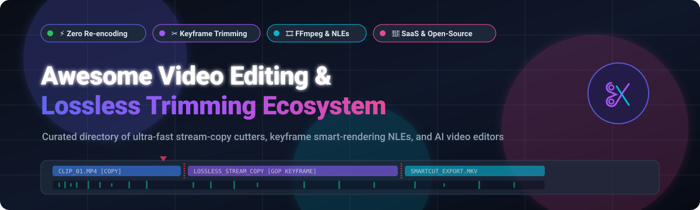

# 🎬 Awesome Video Editing & Lossless Trimming

**A Curated Directory of SaaS Platforms & Open-Source Projects for Stream-Copy Cutting, Smart Rendering, and Modern Video Workflows**

*High-speed video trimming • Zero-reencode stream copy (`-c copy`) • Keyframe smart cutting • Automated silence detection • Timeline NLEs*

---

## 📌 Table of Contents
- [📖 Overview & SEO Summary](#-overview--seo-summary)
- [📊 Sector Overview & Market Dynamics](#-sector-overview--market-dynamics)
- [☁️ SaaS & Hosted Video Trimming Platforms](#️-saas--hosted-video-trimming-platforms)
- [💻 Open-Source GitHub Projects](#-open-source-github-projects)
- [📈 Star History](#-star-history)
- [🤝 How to Contribute](#-how-to-contribute)
- [💖 Support](#-support)
- [⚖️ Disclaimer & License](#️-disclaimer--license)

---

## 📖 Overview & SEO Summary

The **Awesome Video Editing & Lossless Trimming** repository is an authoritative, search-optimized index covering the full spectrum of modern digital video cutting tools. It aggregates both enterprise cloud video creation suites (SaaS) and high-performance open-source video trimmers.

### Key Focus Areas:
- **Instant Stream Copy (`-c copy`)**: Trimming, slicing, and container remuxing (MP4, MKV, MOV, WebM, TS) without decoding or re-encoding, preserving 100% original visual fidelity at drive I/O speeds.
- **Smart Rendering / Smart Cut**: Frame-accurate trimming that decodes and re-encodes solely the Group of Pictures (GOP) spanning cut boundaries while bit-copying interior frames.
- **Automated Silence & Scene Trimming**: Algorithmic detection of silence gaps, static pauses, and shot cuts via OpenCV, VAD, and Whisper speech timestamps.
- **Non-Linear Editors (NLEs)**: Multi-track timeline desktop and browser editors providing proxy workflows, EDL/XML timeline interchange, and lossless batch slicing.

---

## 📊 Sector Overview & Market Dynamics

The global video editing and processing software market is valued at approximately **$2.9B to $3.75B in 2024–2026** and is expanding at a compound annual growth rate (**CAGR**) of **5.2% to 7.9%**, propelled by creator-economy media consumption, enterprise short-form video marketing, and automated AI video workflows. The sector exhibits a **moderately fragmented barbell market structure**: incumbent enterprise giants (such as Adobe and Microsoft) capture substantial revenue share at the suite level, while rapid consumer and developer adoption fuels specialized, agile cloud-native platforms (VEED.IO, Descript, InVideo) and an indispensable layer of foundational open-source engines (FFmpeg, LosslessCut, HandBrake, MLT).

---

## ☁️ SaaS & Hosted Video Trimming Platforms

The table below lists leading commercial SaaS video editors and trimming utilities, sorted by company size (**Valuation / Annual Revenue** in descending order), complete with specific starting plan pricing and free tier restrictions.

| Platform | Company Valuation / Revenue | Starting Price | Free Tier / Free Trial Limits | Key Capabilities |
| :--- | :--- | :--- | :--- | :--- |
| **[Microsoft Clipchamp](https://clipchamp.com)** | **$3.1T+ Market Cap** (Microsoft) | **$9.99/month** (Microsoft 365 Personal bundle) | **Free Forever Plan**: Unlimited watermark-free exports up to 1080p Full HD; access to basic filters and free stock library (4K exports require paid tier) | Integrated browser/Windows editor, multi-track trimming, auto-captions, and screen recording. |
| **[Adobe Express Video Editor](https://adobe.com)** | **$215B+ Market Cap** (Adobe Inc.) | **$9.99/month** (Billed month-to-month, or $99.99/year) | **Free Forever Plan**: Free exports up to 1080p without watermark; includes 25 monthly generative AI credits and 5 GB cloud storage (4K exports & premium stock require Premium) | Web-based video trimmer, speed adjuster, reverse, and social video resizing with Adobe Creative Cloud sync. |
| **[Descript](https://descript.com)** | **$550M Valuation** (~$55M-$100M ARR) | **$24/month** (Hobbyist tier, or $16/mo billed annually) | **Free Forever Plan**: 1 media hour of transcription/upload per month, 720p maximum export resolution with watermark, 100 AI credits, 5 GB storage | Transcript-driven video & podcast editor; trim video timeline simply by editing text transcripts. |
| **[InVideo AI](https://invideo.io)** | **$200M Valuation** (~$30M ARR) | **$20/month** (Starter tier, or $10/mo billed annually) | **Free Trial / Sandbox Only**: 10 minutes of scripted preview testing; exports are disabled or heavily watermarked until upgrading to a paid tier | Prompt-to-video AI generator, script-based timeline trimming, automated scene assembly, and social exports. |
| **[VEED.IO](https://veed.io)** | **$160M Valuation** (~$45M-$50M ARR) | **$25/month** (Creator tier, or $12/mo billed annually) | **Free Forever Plan**: Export videos up to 10 minutes per project, 720p maximum resolution, 2 GB storage, 10 min/month auto-subtitles; all free exports include a "Made with VEED" watermark | Browser-based video editor, automatic silence removal, AI subtitles, clean-audio filters, and social aspect formatting. |
| **[Kapwing](https://kapwing.com)** | **$44M Valuation** (~$10M ARR) | **$24/month** (Pro tier, or $16/mo billed annually) | **Free Forever Plan**: Exports capped at 4 minutes per video, 720p export quality, 250 MB single-file upload limit, 10 AI trial credits; exported videos contain Kapwing watermark | Cloud timeline video editor, Smart Cut automated silence trimming, waveform visualization, and collaborative workspaces. |
| **[Bandicut](https://bandicam.com)** | **~$6.8M Annual Revenue** (Bandicam Company) | **$27.95/year** (or $34.95 1-PC lifetime license) | **Free Evaluation Edition**: Unlimited usage period; high-speed stream copying available but appends a mandatory Bandicut animated watermark at the end of each exported file | High-speed stream copy video cutter and joiner without re-encoding; hardware-accelerated precision cutting. |
| **[123Apps Online Video Cutter](https://online-video-cutter.com)** | **~$2M-$5M Annual Revenue** (Bootstrapped) | **$6.00/month** (or $48.00/year billed annually) | **Free Forever Plan**: Maximum 500 MB upload file size limit; capped at 5 file processing operations per day; ad-supported interface | Instant browser-native video trimmer, frame cropper, rotator, and volume booster without desktop client installation. |
| **[SolveigMM Video Splitter](https://solveigmm.com)** | **~$1M-$3M Annual Revenue** (Privately Held) | **$7.49/month** (or $49.95 Home / $200 Business perpetual) | **7-Day Full Free Trial**: Unrestricted trial for 7 days; subsequent Free Edition enforces output restrictions on file-joining operations and applies preview watermarks on select formats | Smart-rendering video cutter; re-encodes only boundary GOP transition frames around cut points while stream-copying the interior. |
| **[Clideo Video Cutter](https://clideo.com)** | **~$300K-$1M Annual Revenue** (Privately Held) | **$12/month** (or $9/month billed annually at $108/yr) | **Free Forever Plan**: Up to 500 MB upload size per file, capped at 720p resolution; all exported video clips contain Clideo watermark | Cloud-hosted video trimming and merging utility supporting MP4, MOV, MKV, and AVI direct extraction. |

---

## 💻 Open-Source GitHub Projects

A comprehensive collection of open-source video editing engines, lossless stream-copy trimmers, smart-cut encoders, and automated silence cutters. Sorted by **GitHub Star Count** (descending).

| Repository & Stargazers | Primary Focus | Language / Tech Stack | Description |
| :--- | :--- | :--- | :--- |
| **[OpenCut-app/OpenCut](https://github.com/OpenCut-app/OpenCut)**  | Modern Local NLE | TypeScript / Next.js / WebCodecs | Fully open-source web and desktop CapCut alternative offering multi-track timeline trimming, transitions, effects, and private local-first export workflows. |
| **[FFmpeg/FFmpeg](https://github.com/FFmpeg/FFmpeg)**  | Core Multimedia Engine | C / Assembly | The definitive multimedia framework enabling lossless keyframe trimming (`-ss` / `-to` `-c copy`), container remuxing, demuxing, concat protocol stream copy, and filtergraph manipulation. |
| **[mifi/lossless-cut](https://github.com/mifi/lossless-cut)**  | Lossless Trimming GUI | TypeScript / Electron / FFmpeg | The Swiss-army knife of lossless video/audio editing. Instantaneous zero-reencode cutting, merging, segment reordering, chapter marking, and multi-track audio/subtitle stream extraction. |
| **[mpv-player/mpv](https://github.com/mpv-player/mpv)**  | Video Player & CLI Trimmer | C / Lua / libmpv | Command-line media player with powerful Lua scripting capabilities; powers community extensions (`mpv-cut`, `mpv-slicing`) for hotkey-driven instantaneous lossless clip exporting during playback. |
| **[m-bain/whisperX](https://github.com/m-bain/whisperX)**  | Audio Alignment & Trimming | Python / PyTorch / Whisper | Speech recognition engine with word-level timestamp alignment and speaker diarization, used for automating speech-based timeline cutting and silence excision. |
| **[HandBrake/HandBrake](https://github.com/HandBrake/HandBrake)**  | Transcoder & Range Trimmer | C / C++ / Objective-C | Open-source multi-platform video transcoder supporting precise chapter, second, and frame-range trimming, video filtering, and hardware-accelerated batch encoding. |
| **[ffmpegwasm/ffmpeg.wasm](https://github.com/ffmpegwasm/ffmpeg.wasm)**  | Browser WebAssembly Engine | C / WebAssembly / JavaScript | Pure client-side WebAssembly port of FFmpeg enabling web applications to execute lossless video stream trimming (`-c copy`) entirely in the user's browser with zero cloud server compute costs. |
| **[mltframework/shotcut](https://github.com/mltframework/shotcut)**  | Desktop NLE Editor | C++ / Qt / MLT Framework | Mature cross-platform non-linear video editor supporting native timeline scrubbing, keyframe trimming, EDL export, proxy editing, and lossless intermediate codecs. |
| **[gyroflow/gyroflow](https://github.com/gyroflow/gyroflow)**  | Video Stabilization & Trimming | Rust / QML / OpenCV | Advanced video stabilization using gyro sensor data; includes integrated timeline in/out point trimming and high-throughput GPU-accelerated export pipelines. |
| **[olive-editor/olive](https://github.com/olive-editor/olive)**  | Professional Node NLE | C++ / Qt / OpenGL | Fast, professional open-source non-linear video editor featuring node-based compositing, frame-accurate trimming, OpenColorIO management, and non-destructive audio/video pipelines. |
| **[OpenShot/openshot-qt](https://github.com/OpenShot/openshot-qt)**  | Accessible Desktop NLE | Python / PyQt / libopenshot | Cross-platform video editor featuring drag-and-drop razor cutting, waveform audio visualization, title animations, and multi-track timeline splitting. |
| **[KDE/kdenlive](https://github.com/KDE/kdenlive)**  | Full-Featured Pro NLE | C++ / KDE / MLT Framework | Flagship multi-track open-source video editor equipped with razor-tool trimming, 3-point editing, ripple/roll edits, proxy workflows, and automated speech-to-text subtitle trimming. |
| **[WyattBlue/auto-editor](https://github.com/WyattBlue/auto-editor)**  | Automated Silence Cutter | Python / FFmpeg | Command-line tool that detects dead silence, audio levels, and motion stagnation to automatically trim videos, outputting directly to Premiere, Resolve, Final Cut Pro, or Shotcut timelines. |
| **[Breakthrough/PySceneDetect](https://github.com/Breakthrough/PySceneDetect)**  | Scene Boundary Cutter | Python / OpenCV / FFmpeg | Automated video scene analysis tool that detects shot boundaries and cuts long footage into discrete scene clips using lossless FFmpeg stream-copying. |
| **[gpac/gpac](https://github.com/gpac/gpac)**  | Packaging & MP4Box Slicer | C / Multimedia Framework | Open-source multimedia framework and `MP4Box` utility capable of lossless MP4/ISOBMFF slicing, segmenting, track demuxing, and DASH/HLS streaming packaging. |
| **[carykh/jumpcutter](https://github.com/carykh/jumpcutter)**  | Silence Speedup Cutter | Python / PyDub | The pioneering tool that automatically detects quiet speech segments in video files and accelerates or cuts silent pauses to streamline lectures and presentations. |
| **[jliljebl/flowblade](https://github.com/jliljebl/flowblade)**  | Precision Linux NLE | Python / GTK / MLT | Multi-track non-linear video editor for Linux designed for precision trimming workflows with magnetic timeline navigation, split-point trimming, and ripple deletes. |
| **[paulpacifico/shutter-encoder](https://github.com/paulpacifico/shutter-encoder)**  | Professional Encoding GUI | Java / FFmpeg / MediaInfo | Media converter GUI featuring a dedicated "Cut without re-encoding" lossless trim mode, timecode insertion, sub-clipping, and broadcast codec conversions. |
| **[ozmartian/vidcutter](https://github.com/ozmartian/vidcutter)**  | Desktop Trimmer & Joiner | Python / PyQt5 / libmpv | Fast cross-platform video trimmer and joiner featuring SmartCut frame-accurate mode for seamless transitions and rapid stream copy clip assembly. |
| **[eibols/ffmpeg_batch](https://github.com/eibols/ffmpeg_batch)**  | Batch Processing GUI | .NET / C# / FFmpeg | Windows batch video converter allowing users to execute stream-copy trimming, automated segment concatenations, and multi-file encoding jobs concurrently. |
| **[omni-media/omniclip](https://github.com/omni-media/omniclip)**  | Browser-Native NLE | TypeScript / WebCodecs / WebGL | Privacy-first client-side web video editor executing rendering and clipping entirely within the browser via WebCodecs with zero backend server dependencies. |
| **[mean00/avidemux2](https://github.com/mean00/avidemux2)**  | Keyframe Stream Slicer | C++ / Qt | Classic, lightweight video editor built specifically for rapid keyframe-accurate cutting (`Copy` mode), container remuxing, and elementary audio/video filtering. |
| **[HHK1/PryntTrimmerView](https://github.com/HHK1/PryntTrimmerView)**  | iOS Mobile Trimmer UI | Swift / AVFoundation | Customizable iOS framework providing visual timeline scrubbers, frame thumbnail generation, and precise in/out range trimming for mobile apps. |
| **[ClipsAI/clipsai](https://github.com/ClipsAI/clipsai)**  | AI Video Clipper | Python / Whisper | Open-source Python library for analyzing long-form video podcasts and automatically extracting, cropping, and trimming engaging short clips for social platforms. |
| **[LeGoffMael/video_editor](https://github.com/LeGoffMael/video_editor)**  | Flutter Cross-Platform UI | Dart / Flutter | Complete Flutter video editing package providing custom timeline sliders, crop bounds, rotation, and range trimming with clean mobile UI integration. |
| **[skeskinen/smartcut](https://github.com/skeskinen/smartcut)**  | Smart Rendering CLI | Python / PyAV / libavcodec | Frame-accurate video cutting utility that re-encodes solely the partial GOP frames surrounding cut points while bit-copying the rest across H.264, H.265, VP9, and AV1. |
| **[pitivi/pitivi](https://github.com/pitivi/pitivi)**  | Linux GStreamer NLE | Python / GTK / GStreamer | Clean non-linear video editor built on GStreamer Editing Services (GES), supporting ripple/roll trimming, keyframing, and standard timeline manipulation. |
| **[shekh/VirtualDub2](https://github.com/shekh/VirtualDub2)**  | Direct Stream Copy GUI | C++ / Win32 | Advanced Windows video capture and linear editing tool featuring Direct Stream Copy mode, frame-by-frame navigation, and wide container support (AVI/MKV/MP4). |
| **[olexandr-klymenko/VideoCutter](https://github.com/olexandr-klymenko/VideoCutter)**  | Minimalist Lossless Cutter | Python / Tkinter / FFmpeg | Ultra-lightweight desktop GUI wrapper for FFmpeg stream-copying, enabling instant zero-quality-loss video trimming with minimal resource usage. |

---

## 📈 Star History

## Star History
#

---

## 🤝 How to Contribute

Contributions from creators, developers, and maintainers are always welcome! 

1. **Fork this repository** to your personal GitHub account.
2. **Create a topic branch** (`git checkout -b feature/add-new-trimmer`).
3. **Add the tool** with verified specifications:
   - For SaaS: Include precise starting plan pricing, free tier/trial boundaries, and company valuation/revenue metrics.
   - For Open Source: Provide the exact GitHub repository link, star count badge, tech stack, and primary capabilities.
4. **Commit your changes** (`git commit -m "Add NewVideoTrimmer to open-source directory"`).
5. **Open a Pull Request** explaining the additions.

---

## 💖 Support

Thank you for exploring this curated repository! If you find this directory valuable for your media production workflows, video engineering pipelines, or software research, please consider supporting the project:

- ⭐ **Star this repository** to help others discover it on GitHub.
- 🍴 **Fork and share** with fellow video editors, developers, and filmmakers.
- ☕ **Buy me a coffee & support ongoing curation**: Visit the [Sponsor Dashboard](https://github.com/sponsors/ishandutta2007) to become a patron or backer.

---

## ⚖️ Disclaimer & License

- All trademarks, logos, and registered brands belong to their respective corporate owners.
- Listings and pricing details reflect available public data as of **November 2026** and may be modified by vendors at any time.
- Distributed under the **MIT License**.
